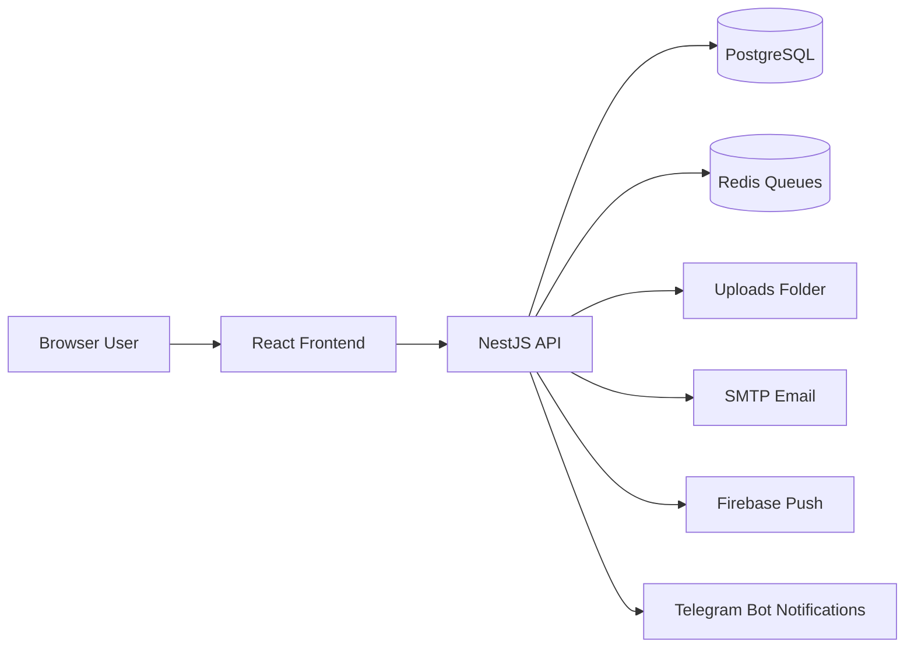

# BMS Developer Documentation

This documentation is the starting point for developers who need to maintain, debug, or extend the Building Management System.

The repository contains two main applications:

| Area | Path | Purpose |
| --- | --- | --- |
| Backend API | `BMS/` | NestJS API for authentication, property management, leasing, finance, maintenance, documents, notifications, reports, and automations. |
| Frontend app | `BMS-frontend/bms-frontend/` | Vite + React + TypeScript web app used by admins, owners, finance users, contractors, and tenants. |

## What This System Does

BMS manages real estate operations across sites, buildings, units, tenants, leases, invoices, payments, documents, maintenance, utilities, visitors, QR/public views, reports, management companies, commissions, tenders, assets, inspections, workforce (internal and agency employees, shifts, assignments, check-ins, and leave requests), and Telegram bot notification integration.

At a high level:



## Recommended Reading Order

1. [Architecture](architecture.md)
2. [Setup and Deployment](setup-and-deployment.md)
3. [Backend Guide](backend.md)
4. [Frontend Guide](frontend.md)
5. [Database Guide](database.md)
6. [Auth and Permissions](auth-and-permissions.md)
7. [Business Flows](business-flows.md)
8. [API Guide](api-guide.md)
9. [Feature Development Guide](feature-development-guide.md)
10. [Troubleshooting](troubleshooting.md)

## Quick Local Commands

Backend:

```bash
cd BMS
npm install
npm run start:dev
```

Frontend:

```bash
cd BMS-frontend/bms-frontend
npm install
npm run dev
```

Docker backend stack:

```bash
cd BMS
docker-compose up --build
```

## Important Runtime URLs

| Service | Default URL |
| --- | --- |
| Backend API | `http://localhost:2546` |
| Swagger docs | `http://localhost:2546/api` |
| Frontend dev app | `http://localhost:5173` |
| Frontend API base env | `VITE_API_BASE_URL` |

## Documentation Maintenance Rule

When a feature changes, update the relevant documentation in this folder.

Typical updates:

| Change | Docs to update |
| --- | --- |
| New backend module | `backend.md`, `api-guide.md`, `feature-development-guide.md` |
| New frontend page | `frontend.md`, `api-guide.md` if it calls new endpoints |
| New table/entity | `database.md` |
| New permission or role behavior | `auth-and-permissions.md` |
| New business workflow | `business-flows.md` |
| New env var or deployment step | `setup-and-deployment.md` |
