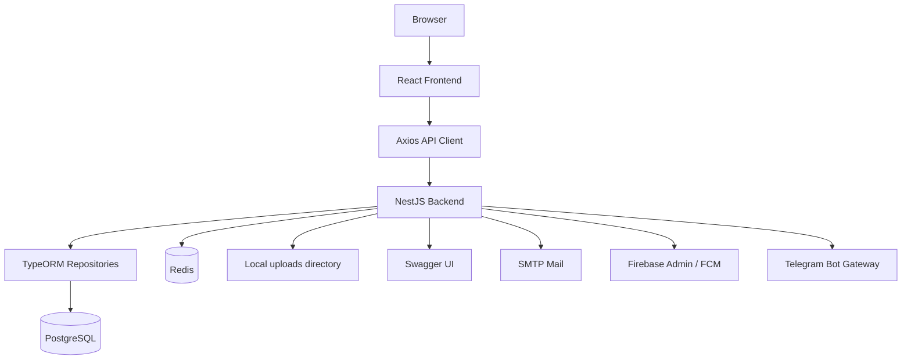
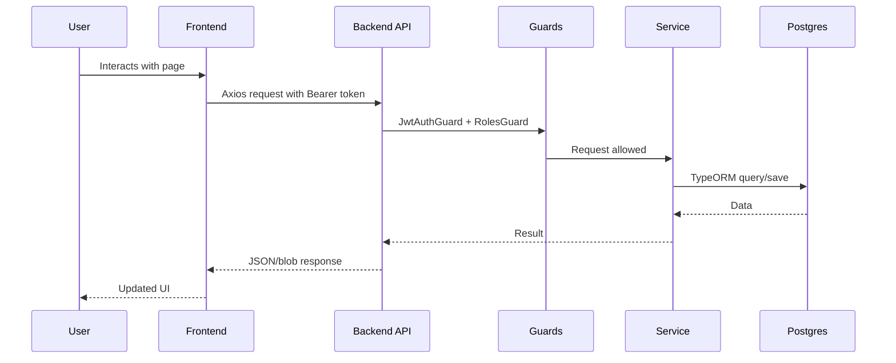

# Architecture

BMS is split into a NestJS backend API and a React frontend.

## Backend Stack

The backend lives in `BMS/`.

Main technologies:

| Technology | Usage |
| --- | --- |
| NestJS | API framework and module structure |
| TypeORM | Entity/repository database access |
| PostgreSQL | Primary database |
| Passport JWT | Bearer-token authentication |
| bcryptjs | Password hashing |
| Swagger | API documentation at `/api` |
| Helmet | Basic HTTP security headers |
| Redis | Queue backing service |
| Bull/BullMQ | Background jobs and notifications |
| Schedule | Cron-style automation jobs |
| Multer | File uploads |
| PDFKit | PDF generation |
| Firebase Admin | Push notification support |
| Telegram Bot API | Real-time bot notification alerts |
| HTML-to-PDF | Dynamic document templates |

The main backend entry points are:

| File | Purpose |
| --- | --- |
| `BMS/src/main.ts` | Bootstraps Nest, CORS, Helmet, static uploads, validation, Swagger, and port binding. |
| `BMS/src/app.module.ts` | Registers global config, TypeORM, static upload serving, throttling, and every feature module. |
| `BMS/docker-compose.yml` | Runs API, Postgres, pgAdmin, and Redis. |
| `BMS/seed-super-admin.ts` | Seeds roles, permissions, default users, unit types, and document templates. |

## Frontend Stack

The frontend lives in `BMS-frontend/bms-frontend/`.

Main technologies:

| Technology | Usage |
| --- | --- |
| React 18 | UI rendering |
| Vite | Development server and build |
| TypeScript | Frontend typing |
| React Router | Route mapping and protected app layout |
| Axios | API requests |
| Tailwind CSS | Styling |
| lucide-react/react-icons | Icons |
| Recharts | Charts and dashboards |
| jwt-decode | Decode JWT roles and permissions |

The main frontend entry points are:

| File | Purpose |
| --- | --- |
| `src/main.tsx` | Mounts React, router, theme provider, and toast provider. |
| `src/App.tsx` | Defines public routes and authenticated routes. |
| `src/api/axios.ts` | Axios instance, API base URL, bearer token injection, 401 handling. |
| `src/components/NavBar.tsx` | Permission-aware navigation. |
| `src/components/ProtectedRoute.tsx` | Redirects unauthenticated users to `/login`. |

## Request Flow

## Major Domains

| Domain | Backend module | Frontend page/API |
| --- | --- | --- |
| Authentication | `auth` | `Login`, `auth/auth.ts` |
| Users and signatures | `users` | `Users`, `Profile`, `LoginHistory` |
| Roles and permissions | `roles` | `Roles` |
| Sites/buildings/units | `sites`, `buildings`, `units`, `unit-types` | `Sites`, `Buildings`, `Units` |
| Owners | `owners` | `Owners` |
| Tenants | `tenants` | `Tenants` |
| Leases | `leases` | `Leases` |
| Finance | `finance` | `Finance` |
| Maintenance | `maintenance` | `Maintenance` |
| Documents | `documents`, `upload` | `Documents` |
| QR/public access | `qr` | `QR`, `PublicUnitView`, `PublicBuildingView` |
| Reports | `reports` | `Reports`, `Dashboard` |
| Notifications | `notifications` | `Notifications`, `NotificationContext` |
| Automations | `automations` | `Automations` |
| Assets/amenities | `assets`, `amenities` | `Assets`, `Amenities` |
| Inspections | `inspections` | `InspectionWorkflow` |
| Management companies | `management` | `Management` |
| Commissions | `commission` | `Commissions` |
| Tenders | `tenders` | `Tenders` |
| Workforce Management | `workforce` | `Workforce`, `api/workforce.ts` |
| Telegram Integration | `notifications` | `Notifications` |

## Design Principles Already Present

- The backend follows NestJS module boundaries: controller for HTTP, service for business logic, DTOs for request shape, entities for database mapping.
- The frontend keeps API calls in `src/api/*` files and page workflows in `src/pages/*`.
- Auth is JWT-based, with roles and permissions embedded in the JWT for UI decisions and verified by the backend for protected endpoints.
- Most business data is stored in Postgres through TypeORM entities.
- Uploaded files are stored under `uploads/` and served via `/uploads`.

