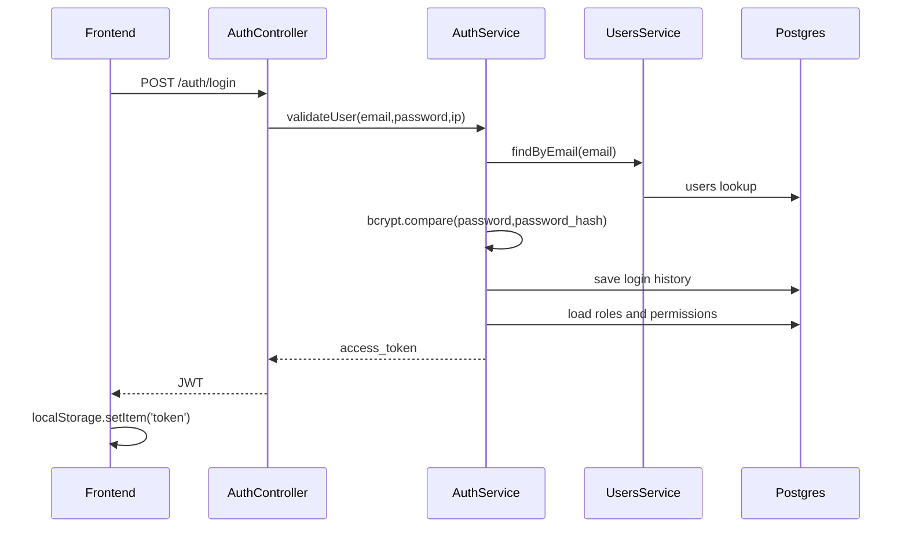

# Auth and Permissions

Authentication is JWT-based. Authorization uses roles and permissions.

## Login Flow



## JWT Payload

`AuthService.login()` signs a payload shaped like:

```json
{
  "sub": "user-id",
  "email": "user@example.com",
  "roles": ["admin"],
  "permissions": ["users:read", "buildings:read"]
}
```

`JwtStrategy.validate()` exposes this on the request as:

```ts
{
  id: payload.sub,
  email: payload.email,
  roles: payload.roles || [],
  permissions: payload.permissions || [],
}
```

## Account Locking

`AuthService.validateUser()`:

- Rejects invalid credentials.
- Tracks failed login attempts.
- Temporarily locks the account for 5 minutes after 5 failed attempts.
- Rejects accounts with status `LOCKED`.
- Resets failed attempts on successful login.
- Writes success/failure records to `login_history`.

## Backend Guards

The common auth decorator is:

```ts
@Auth()
```

Defined in `src/common/decorators/auth.decorator.ts`, it applies:

```ts
UseGuards(JwtAuthGuard, RolesGuard)
ApiBearerAuth()
```

`JwtAuthGuard` uses Passport JWT.

`RolesGuard` checks:

1. Required permissions from `@Permissions(...)`.
2. Required roles from `@Roles(...)`.
3. User roles from `user_roles`.
4. Role permissions from `role_permissions`.
5. JWT permissions as an extra cached source.

`super_admin` bypasses permission checks in `RolesGuard`.

## Permission Decorator

Example:

```ts
@Permissions('finance:payments:verify')
```

This requires the authenticated user to have that permission through one of their roles, unless they are `super_admin`.

## Role Decorator

Example:

```ts
@Roles('super_admin', 'admin', 'owner')
```

This requires the authenticated user to have one of those roles, unless they are `super_admin`.

## Frontend Auth

Frontend login is handled by `src/auth/auth.ts`.

It posts to:

```text
POST /auth/login
```

Then stores the returned token in:

```text
localStorage.token
```

`src/api/axios.ts` injects:

```text
Authorization: Bearer <token>
```

On `401`, the frontend removes the token and redirects to `/login`.

## Frontend Permission Usage

`src/utils/jwt.ts` decodes roles and permissions from the JWT.

`NavBar.tsx` uses permissions and roles to hide/show links.

`PermissionGate.tsx` renders children only if the user has a specific permission.

Important: frontend permission checks are not security by themselves. Always protect backend routes and service logic.

## Workforce Module Permissions

The workforce management feature uses scoped permissions mapped to roles:

| Code | Description | Role Assignments |
| --- | --- | --- |
| `workforce:read` | View agencies, contracts, staff, assignments, attendance, leaves. | super_admin, admin |
| `workforce:create` | Register agencies, contracts, employees, and create assignments. | super_admin, admin |
| `workforce:update` | Edit/save changes to agencies, contracts, and employees. | super_admin, admin |
| `workforce:delete` | Remove agency, contract, or employee records. | super_admin, admin |
| `workforce:attendance` | Track daily check-in, check-out, or mark absent. | super_admin, admin |
| `workforce:leave` | Request leaves, approve leaves, and reject leaves. | super_admin, admin |

## Adding a New Permission

1. Choose a permission code using the existing pattern:

```text
domain:action
domain:resource:action
```

Examples:

```text
users:read
finance:payments:verify
maintenance:work_orders:update
```

2. Add the permission to `seed-super-admin.ts`.
3. Map it to default roles in `seed-super-admin.ts` if needed.
4. Add `@Permissions('new:permission')` to the backend controller method.
5. Add frontend nav visibility or `PermissionGate` if needed.
6. Run the seed script against the database.
7. Log out and back in so the JWT contains the updated permission list.

## Common Gotcha

Permissions are embedded in the JWT at login time. If permissions change in the database, an already logged-in user may need to log in again to get a fresh token.

