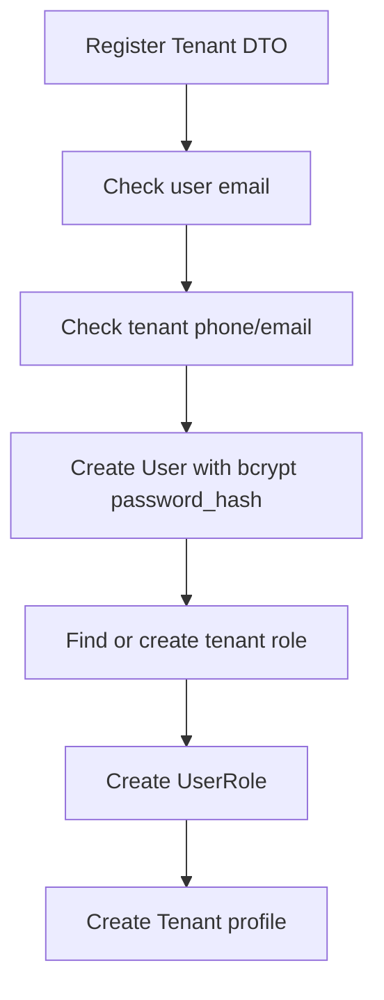
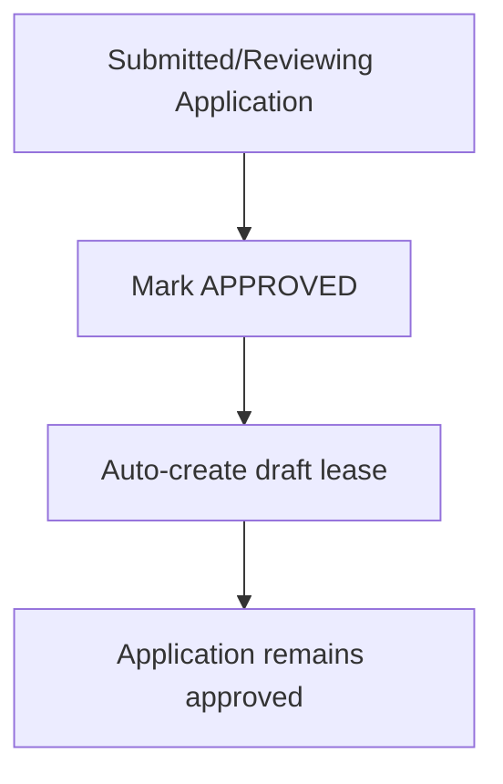
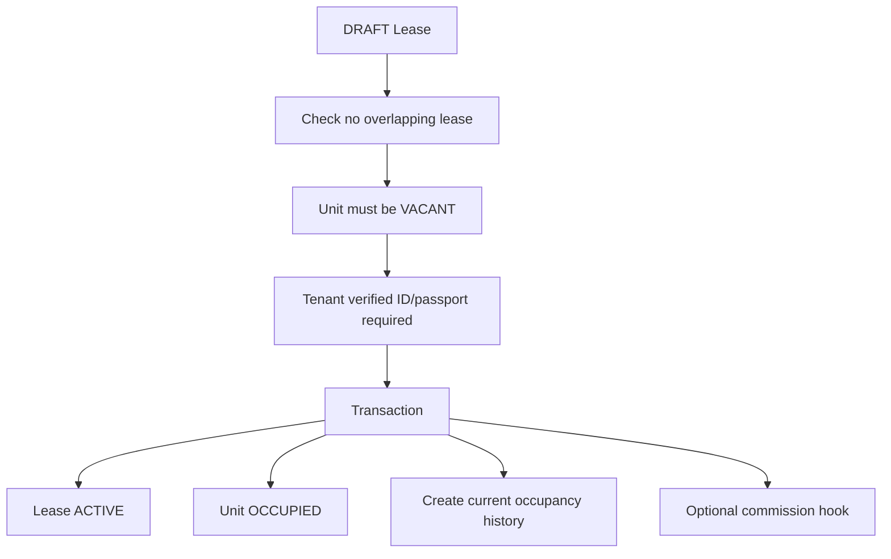
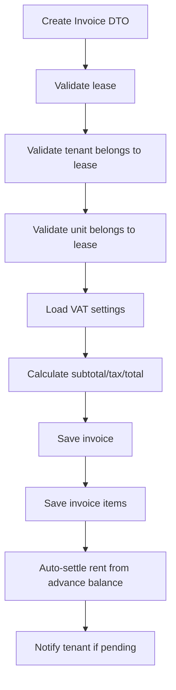
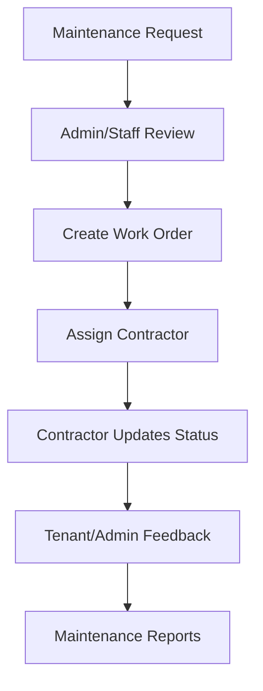
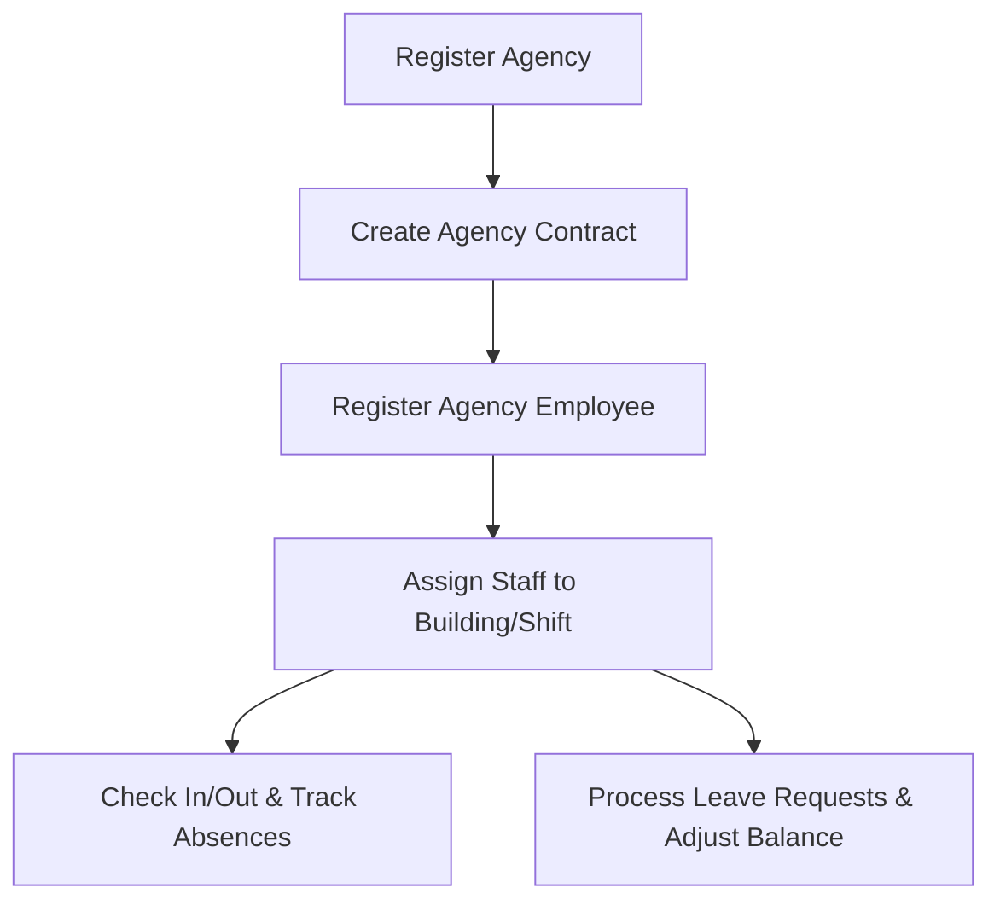
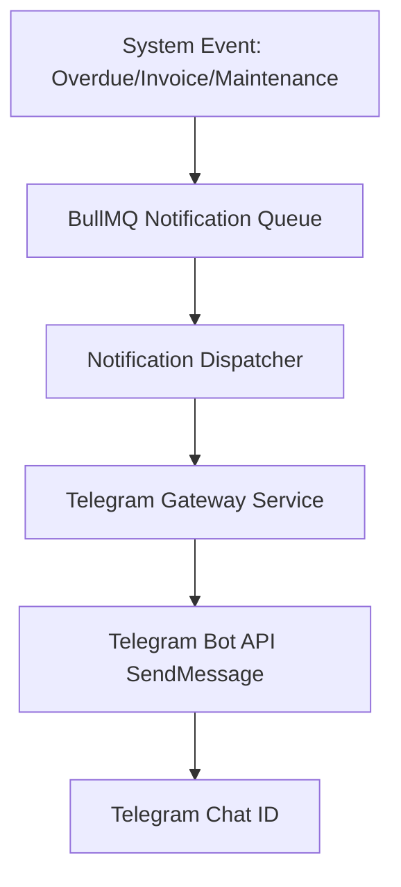

# Business Flows

This file explains how the main BMS workflows move through the codebase.

## Tenant Registration

Backend service: `TenantsService.register()`

Important behavior:

- Creates a `User`.
- Hashes the password.
- Ensures a `tenant` role exists.
- Creates a `UserRole`.
- Creates the `Tenant` profile.

## Tenant Application Approval

Backend service: `TenantsService.approveApplication()`

Important behavior:

- Only submitted or reviewing applications can be approved.
- Approval attempts to auto-create a one-year draft lease.
- If draft lease creation fails, the application approval still stands and the error is logged.

## Lease Creation

Backend service: `LeasesService.create()`

Checks:

- `start_date <= end_date`
- Building exists.
- Tenant exists.
- Unit exists.
- Unit belongs to building.
- Unit status is `VACANT`.
- No overlapping draft/active/renewed lease exists for the unit.
- Owners can only create leases for their own buildings.

Result:

- Creates a lease with status `DRAFT`.

## Lease Activation

Backend service: `LeasesService.activate()`

Important behavior:

- Only `DRAFT` leases can be activated.
- Tenant must have a verified ID/passport-style document.
- The unit becomes `OCCUPIED`.
- A current `UnitOccupancyHistory` record is created.
- If the lease has `managed_by_company_id`, commission calculation can run.

## Lease Termination

Backend service: `LeasesService.terminate()`

Important behavior:

- Only `ACTIVE` or `RENEWED` leases can be terminated.
- Early termination penalty can be calculated from organization settings.
- Deposit/advance balance refund can create a finance expense.
- Penalty can create a finance invoice.
- Lease becomes `TERMINATED`.
- Unit becomes `VACANT`.
- Current occupancy history becomes previous.

## Lease Renewal

Backend service: `LeasesService.renew()`

Important behavior:

- Only `ACTIVE` or `EXPIRED` leases can be renewed.
- New dates must not overlap existing leases.
- If rent is not provided, rent escalation can be applied from organization settings.
- Current lease becomes `RENEWED`.
- New lease is created as `DRAFT`.

## Invoice Creation

Backend service: `FinanceService.createInvoice()`

Important behavior:

- Requires organization settings for VAT.
- Generates invoice numbers like `INV-001`.
- Can create draft or pending invoices.
- Rent items can be auto-settled from `lease.advance_balance`.
- Pending invoices trigger notifications.

## Payment Submission and Verification

Backend service: `FinanceService.createPayment()` and `FinanceService.verifyPayment()`

Payment submission:

- Validates invoice exists.
- Creates payment with status `PENDING`.
- Sets invoice status to `PROCESSING`.

Payment confirmation:

- Sets payment status to confirmed.
- Adds payment amount to invoice `amount_paid`.
- Updates invoice to `PAID` or `PARTIAL`.
- Overpayment is added to `lease.advance_balance`.
- Updates selected/default bank account balance.
- Triggers commission calculation for rent-related payment.
- Notifies tenant.

Payment rejection:

- Marks payment rejected.
- Reverts invoice status to `DRAFT`.
- Stores rejection reason in payment note.

## Automations

Backend service: `AutomationCronService`

Seeded jobs:

| Job | Schedule | Behavior |
| --- | --- | --- |
| `lease-expiry` | Daily at 1 AM | Notifies tenants when leases expire in 30, 14, or 7 days. |
| `payment-deadline` | Daily at 1 AM | Sends due-soon reminders and marks overdue invoices. |
| `utility-sync` | Monthly on day 25 at 1 AM | Notifies tenants with unbilled utility readings. |
| log cleanup | Daily at 2 AM | Deletes job logs older than 3 months. |

Jobs can be enabled/disabled and manually triggered through `/automations`.

## Maintenance Flow

Backend module: `maintenance`

General flow:

The module also includes contractors, maintenance schedules, SLA checks, and recurring schedule execution.

## Notification Flow

Backend module: `notifications`

Notifications can be created by finance, tenant messages, announcements, automations, and other modules.

The module supports:

- In-app notification records.
- Read/read-all/delete operations.
- Announcements.
- FCM device token registration.
- Push notification sending.
- Email through `MailService`.
- A BullMQ `notification` queue.

## QR/Public View Flow

Backend module: `qr`

Frontend pages:

- `PublicUnitView`
- `PublicBuildingView`
- `QR`

Behavior:

- Authenticated users can generate unit/building QR tokens.
- Public routes can fetch unit/building information by token.
- Scan logs and analytics are tracked.
- QR codes can be deactivated.
- QR data can be exported as PDF.

## Owner and Scoped Access

Several services filter data by role:

- Tenants can see their own tenant/lease/finance data.
- Owners are filtered to buildings they own.
- Nominee admins can be filtered by assigned buildings/units and management company assignments.
- Super admins generally see all data.

Do not rely only on frontend navigation. Service-level filtering is part of the security model.

## Workforce Management Flow

Backend service: `WorkforceService`

Important behavior:
- Agency employees must map to an active, registered agency.
- Internal employees have an annual leave balance tracker. When a leave request is `approved`, their leave balance is automatically decremented by the request's calculated range of days. If the leave status changes away from approved, the balance is restored.
- Daily check-in checks if the employee is assigned to an active building and shift. If checked in after shift start, a calculated `late_minutes` integer is saved.

## Telegram Notification Flow

Backend integration: `NotificationsModule` / `TelegramService`

Important behavior:
- Administrators can link their accounts to a Telegram Bot by verifying their unique chat identifier.
- The notifications dispatcher listens for system alerts and forwards messages to the Telegram Service, sending instant alerts for critical events like fire alarms, invoice payments, or new maintenance tickets.

