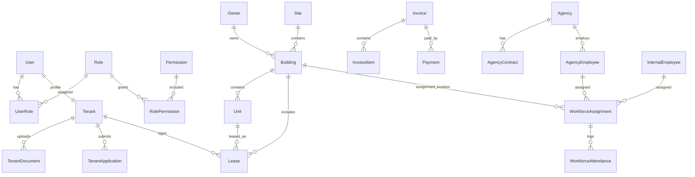

# Database Guide

The backend uses PostgreSQL with TypeORM.

## Configuration

Database connection is configured in `BMS/src/app.module.ts`:

```ts
TypeOrmModule.forRoot({
  type: 'postgres',
  host: process.env.DB_HOST || 'localhost',
  port: parseInt(process.env.DB_PORT ?? '5432', 10),
  username: process.env.DB_USERNAME || 'postgres',
  password: process.env.DB_PASSWORD || 'postgres',
  database: process.env.DB_NAME || 'bms_db',
  autoLoadEntities: true,
  synchronize: true,
})
```

Environment variables:

| Variable | Purpose |
| --- | --- |
| `DB_HOST` | Postgres host |
| `DB_PORT` | Internal Postgres port used by the API |
| `DB_USERNAME` | Postgres username |
| `DB_PASSWORD` | Postgres password |
| `DB_NAME` | Database name |
| `DB_PORT_EXTERNAL` | Host port exposed by Docker Compose |
| `PGADMIN_PORT` | Host port for pgAdmin |

## Schema Management

The current code uses:

```ts
synchronize: true
```

This means TypeORM updates the database schema from entity definitions when the app starts.

Important implications:

- Entities are the source of truth for table/column definitions.
- There are no migration files in the inspected codebase.
- This is convenient in development.
- In production, `synchronize: true` can be risky because schema changes happen automatically. A safer long-term standard is to use TypeORM migrations.

## Core Entity Relationships



## Main Tables

| Table | Entity | Purpose |
| --- | --- | --- |
| `users` | `User` | Login accounts, status, failed login counters, company link. |
| `roles` | `Role` | System/custom roles. |
| `permissions` | `Permission` | Permission codes such as `users:read`. |
| `user_roles` | `UserRole` | Many-to-many user-role link. |
| `role_permissions` | `RolePermission` | Many-to-many role-permission link. |
| `owners` | `Owner` | Building owners. |
| `sites` | `Site` | Site/location grouping for buildings. |
| `buildings` | `Building` | Building records, owner, site, address, location, status. |
| `units` | `Unit` | Rentable spaces, status, rent, floor, type, image. |
| `tenants` | `Tenant` | Tenant profile linked to a user. |
| `tenant_applications` | `TenantApplication` | Applications for units. |
| `tenant_documents` | `TenantDocument` | Tenant verification documents. |
| `leases` | `Lease` | Lease contract, dates, rent, billing cycle, status, deposit, advance balance. |
| `unit_occupancy_history` | `UnitOccupancyHistory` | Current and previous occupancy records. |
| `lease_payments` | `LeasePayment` | Lease payment schedule/status records. |
| `invoices` | `Invoice` | Invoice header, totals, paid amount, status. |
| `invoice_items` | `InvoiceItem` | Rent, penalty, utility, or other invoice lines. |
| `payments` | `Payment` | Tenant payment submissions and verification status. |
| `bank_accounts` | `BankAccount` | Bank account balances and metadata. |
| `expenses` | `Expense` | Building/organization expenses. |
| `deposit_advices` | `DepositAdvice` | Bank deposit advice records. |
| `maintenance_requests` | `MaintenanceRequest` | Tenant/admin maintenance requests. |
| `contractors` | `Contractor` | Contractor profiles. |
| `work_orders` | `WorkOrder` | Work assigned to contractors. |
| `maintenance_feedback` | `MaintenanceFeedback` | Feedback on work orders. |
| `maintenance_schedules` | `MaintenanceSchedule` | Recurring/scheduled maintenance. |
| `documents` | `Document` | Uploaded/generated documents and templates. |
| `document_versions` | `DocumentVersion` | Document version history. |
| `qrcodes` | `QRCode` | Unit/building QR tokens. |
| `qr_scan_logs` | `QRScanLog` | Public QR scan analytics. |
| `notifications` | `Notification` | In-app notifications. |
| `user_device_tokens` | `UserDeviceToken` | FCM device tokens. |
| `automation_jobs` | `AutomationJob` | Job enable/disable state and metadata. |
| `job_logs` | `JobLog` | Automation execution logs. |
| `utility_meters` | `UtilityMeter` | Unit/building utility meters. |
| `meter_readings` | `MeterReading` | Utility readings and billing flags. |
| `assets` | `Asset` | Property asset inventory. |
| `amenities` | `Amenity` | Amenity catalog. |
| `building_amenities` | `BuildingAmenity` | Building-amenity link. |
| `unit_amenities` | `UnitAmenity` | Unit-amenity link. |
| `management_companies` | `ManagementCompany` | External/internal management companies. |
| `management_assignments` | `ManagementAssignment` | Company assignment to buildings/units. |
| `management_permissions` | `ManagementPermission` | Management company permissions. |
| `commissions` | `Commission` | Commission records. |
| `commission_rules` | `CommissionRule` | Commission calculation rules. |
| `commission_payments` | `CommissionPayment` | Commission payment batches. |
| `commission_payment_items` | `CommissionPaymentItem` | Commission payment details. |
| `lease_tenders` | `LeaseTender` | Lease tender listings. |
| `tender_bids` | `TenderBid` | Bids on tenders. |
| `inspections` | `Inspection` | Inspection workflow header. |
| `inspection_items` | `InspectionItem` | Inspection checklist items. |
| `organization_settings` | `OrganizationSettings` | Branding, VAT, withholding, penalties, policy settings. |
| `admin_activity_logs` | `AdminActivityLog` | Audit trail. |
| `workforce_agencies` | `Agency` | Registered outsourcing agencies. |
| `workforce_agency_contracts` | `AgencyContract` | Contracts with outsourcing agencies. |
| `workforce_agency_employees` | `AgencyEmployee` | Employees hired through outsourcing agencies. |
| `workforce_internal_employees` | `InternalEmployee` | In-house employee directory with leave balance tracking. |
| `workforce_assignments` | `WorkforceAssignment` | Staff building assignments, floor, shift, and start/end dates. |
| `workforce_attendance` | `WorkforceAttendance` | Daily check-in/out records, status, late minutes, and notes. |
| `workforce_leave_requests` | `WorkforceLeaveRequest` | Internal employee leave requests, approval decisions, and notes. |

## Important Status Enums

| Entity | Important statuses |
| --- | --- |
| `User` | `ACTIVE`, `LOCKED`, `INACTIVE` |
| `Unit` | `VACANT`, `OCCUPIED`, `MAINTENANCE`, `RESERVED` |
| `Tenant` | `active`, `blacklisted` |
| `Lease` | `DRAFT`, `ACTIVE`, `EXPIRED`, `TERMINATED`, `RENEWED` |
| `Invoice` | `pending`, `paid`, `partial`, `overdue`, `cancelled`, `processing`, `draft` |
| `Agency` / `AgencyContract` / `AgencyEmployee` | `active`, `inactive`, `suspended`, `renewal_due`, `expired`, `terminated`, `on_leave` |
| `WorkforceAttendance` | `present`, `late`, `absent`, `incomplete` |
| `WorkforceLeaveRequest` | `pending`, `approved`, `rejected`, `cancelled` |

## Adding Database Fields

For the current setup:

1. Update the relevant entity in `BMS/src/modules/<module>/entities`.
2. Update DTOs if the field is accepted from the API.
3. Update service create/update logic.
4. Update frontend API types or page fields.
5. Restart the backend so TypeORM syncs the schema.
6. Test in Swagger and in the frontend.

Long-term production recommendation:

1. Set `synchronize: false`.
2. Generate and review a TypeORM migration.
3. Run migrations during deployment.

